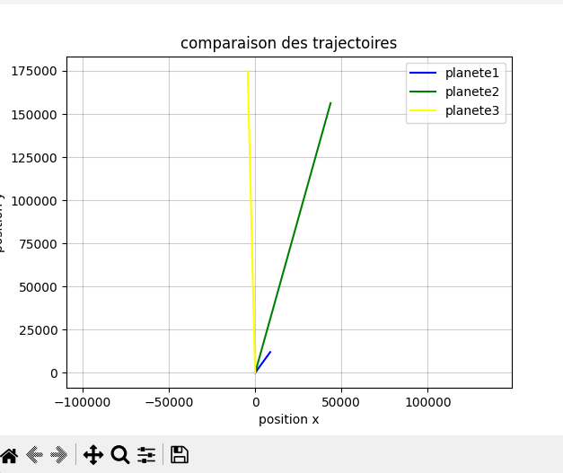
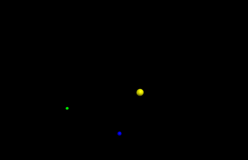

# Three-Body Problem

In physics, Newton's law of universal gravitation gives the gravitational force between two planets or objects. Using Newton's second law, F = ma, we can then find the acceleration of each body, then its velocity, and finally its position in space.

For three bodies, there is no general closed-form solution. Instead, the equations of motion are solved numerically: the positions and velocities of the bodies are updated step by step, using a small time step `dt`.

## Files

- `general.py`: lets you change the masses and initial positions to animate the three bodies.
- `graph.py`: shows how the trajectories change when the masses and initial positions change.
- `realplanets2D.py` and `realplanets3D.py`: real-data versions of `general.py`. They use the actual positions and velocities of the Sun, the Earth and Mars on 10 November 2026 at 00:00 to animate the real planets.



## Installation

Make sure you have Python 3 installed, then install the dependencies:

```bash
pip install pygame vpython
```

## Usage

Run the scripts from the project folder:

```bash
py general.py           # animation with custom masses and positions
py graph.py             # trajectory graphs
py realplanets3D.py     #animation with the sun,Earth and Mars on 3D
py realplanets2D.py     #animation with the sun,Earth and Mars on 2D
```

On macOS or Linux, use `python3` instead of `py`:

```bash
python3 general.py
```
## Parameters

`dt`: time step (seconds) 
`scale`: conversion from km to scene units 


## Limitations

- other planets are not simulated
- Sphere radii are not to scale
- Euler integration loses accuracy over very long runs
#Author

Amina CHABANE, 2026